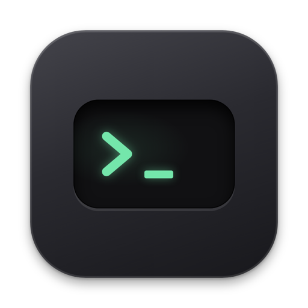

<p align="center"></p>

<h1 align="center">Hatch</h1>

<p align="center"><b>Терминал по одной клавише.</b> Нажал <kbd>⌥</kbd><kbd>Space</kbd>, выполнил команду, закрыл.</p>

<p align="center">
  <a href="https://github.com/3Danger/hatch/releases/latest"><b>Скачать для macOS</b></a> · macOS 26+ · бесплатно, MIT
</p>

<p align="center"></p>
<p align="center"><a href="docs/media/demo.mp4">Видео в хорошем качестве</a></p>

## Зачем

Нужна одна команда, а терминал — это отдельное окно, вкладки и поиск, где что запускал.
Hatch выезжает поверх любого приложения, выполняет команду в вашем шелле и оставляет вывод
в истории. Закрыли — и вы снова там, где были.

## Что умеет

- **Ваш шелл.** zsh или bash с `~/.zshrc`: алиасы, функции, цвета. `ssh`, `vim`, `htop` открываются прямо в панели.
- **История блоками.** Каждая команда — блок с выводом и статусом: повторить, скопировать, закрепить.
- **Фильтр без перезапуска.** «+» у блока добавляет `grep`, `sort` или `jq` к сохранённому выводу. Сама команда не выполняется снова.
- **Папки с клавиатуры.** <kbd>⌘1</kbd> — дерево папок, ★ — избранные папки и команды.
- **Поиск.** <kbd>⌘F</kbd> ищет по всем командам и их выводу.
- **Автодополнение как в zsh.** TAB и подсказка из истории, без задержек.
- **Приложения и калькулятор, как в Spotlight.** `safari` и Enter открывают Safari, `code .` — текущую папку в VS Code. `(1200-150)/3` сразу показывает 350, Enter копирует результат.

## Установка

1. Скачайте `Hatch-<версия>.zip` со страницы [Releases](https://github.com/3Danger/hatch/releases/latest) и перенесите `Hatch.app` в «Программы».
2. Hatch не подписан сертификатом Apple, поэтому первый запуск macOS заблокирует. Разрешите его в «Системные настройки» → «Конфиденциальность и безопасность» → «Всё равно открыть» или командой:

```bash
xattr -dr com.apple.quarantine /Applications/Hatch.app
```

3. Нажмите <kbd>⌥</kbd><kbd>Space</kbd>. Hatch живёт в строке меню, в Dock его нет.

macOS попросит разрешение на уведомления (о завершении долгих команд) и на доступ к папкам, когда команда впервые к ним обратится.

## Главные клавиши

| Клавиши | Что делает |
|---|---|
| <kbd>⌥</kbd><kbd>Space</kbd> | показать или скрыть Hatch (меняется в настройках) |
| <kbd>Enter</kbd> · <kbd>Tab</kbd> | выполнить команду · дополнить |
| <kbd>↑</kbd> <kbd>↓</kbd> | листать историю команд |
| <kbd>⌘F</kbd> | поиск по командам и выводу |
| <kbd>⌘1</kbd> | дерево папок (меняется в настройках) |
| <kbd>⌘E</kbd> · <kbd>⌘D</kbd> | избранное · текущая папка в избранное |
| <kbd>⌃L</kbd> | убрать завершённые блоки (можно отменить) |

<details>
<summary><b>Все сочетания</b></summary>

| Клавиши | Где | Что делает |
|---|---|---|
| ⌥Space (настраивается) | везде | показать или скрыть панель |
| Enter | поле ввода | выполнить команду; с подписью справа — открыть приложение или скопировать результат |
| Tab · ⇧Tab | поле ввода | дополнить; при нескольких вариантах — общая часть, затем перебор вперёд и назад |
| Esc | поле ввода | вернуть набранное до перебора вариантов |
| → | поле ввода | принять серую подсказку: из истории или имя приложения (его дописывает и Tab) |
| ↑ / ↓ | панель | листать историю команд |
| ⌃C | раскрытый блок | прервать команду |
| ⌘W | раскрытый блок | свернуть блок |
| ⌘F | панель | поиск по истории и обратно (в раскрытом выводе — поиск по нему) |
| ⌘E | панель | избранное: папки и команды |
| ⌘1 (настраивается) | панель | дерево папок у текущей папки |
| ⌘D | панель | текущую папку в избранное или обратно |
| ⌃L | панель | убрать завершённые блоки (как команда `clear`) |
| ⌘Q | панель | выйти из Hatch |
| ↑ / ↓ · Enter · Esc | поиск | по найденным блокам · раскрыть · выйти |
| ↑ ↓ → ← · Space · буквы | дерево папок | по строкам, раскрыть и войти, выше · свернуть · к папке по имени |
| Enter · ⌘← ⌘→ · Esc | дерево папок | перейти, как `cd` · соседняя папка пути · закрыть |

</details>

<details>
<summary><b>Все возможности</b></summary>

**Команды**
- Выполняются в вашем шелле (`$SHELL`) в настоящем псевдотерминале: цвет, прогресс-бары, `less`, `ssh`, <kbd>⌃C</kbd>.
- `cd` меняет папку Hatch, в том числе в цепочках (`cd sub && ls`). Последняя папка запоминается.
- Интерактивные программы (`vim`, `top`, `ssh`, `man`, REPL) открываются живым терминалом в блоке.
- Пейджер отключён (`PAGER=cat`): `git log` выводится целиком.
- Уведомление о завершении долгой команды (от 5 секунд), если панель не в фокусе.

**История**
- Блок показывает команду, папку, время, статус и вывод с цветом. Длинный вывод — началом и концом, середина сворачивается.
- Клик раскрывает блок: готовый — весь вывод, работающий — живой терминал.
- Повтор в том же блоке, закрепление, очистка по уровням. `clear` и <kbd>⌃L</kbd> убирают завершённые блоки, 5 секунд можно отменить.

**Конвейер**
- Шаги `grep`, `sort`, `jq` работают с сохранённым выводом — безопасно даже для `rm`, `curl -X POST` и деплоя.
- Шаги видны плашками, их можно поправить или убрать. Подсказки: недавние шаги, частые фильтры, команды и файлы.

**Ввод**
- Автодополнение команд, алиасов, файлов и папок без запуска шелла на каждое нажатие.
- Серая подсказка из истории, как zsh-autosuggestions.
- Над полем — текущая папка. Клик или <kbd>⌘1</kbd> — дерево папок, <kbd>⌘</kbd>-клик — скопировать путь, правый клик — меню папки (избранное, Finder, редакторы, «Поделиться», недавние папки).
- Латинская раскладка в поле включается сама и возвращается при скрытии.

**Приложения и калькулятор**
- Имя приложения и Enter открывают приложение: `safari`, `калькулятор`, `visual studio code`. Справа в поле заранее видно, что произойдёт; в историю запуск не попадает.
- По первым буквам — только подсказка: `saf` дописывается до `safari` по Tab или →.
- Имя и пути открывают пути в приложении: `code .`, `zed ~/proj`. Если аргумент не существующий путь (`docker ps`), это команда.
- Совпадение с командой решается в пользу приложения. Имена, которые должны оставаться командами, добавляются в исключения в настройках; по умолчанию там `claude`, `ollama` и `opencode`.
- Алиасы приложений настраиваются; по умолчанию `code` и `vscode` — VS Code.
- Приложения ищутся в «Программах», системных программах и `~/Applications`, на уровень вглубь.
- Калькулятор: `+ - * / ^ %` и скобки, `4500*15%` = 675. Enter копирует результат и скрывает панель.

**Панель**
- Сплошная, без стекла, в стиле системных настроек macOS. Высота — по содержимому, размер и позиция запоминаются.
- Скрывается по клику в другом приложении.
- Значок в строке меню можно скрыть: тогда Hatch открывается хоткеем или повторным запуском.
- Настройки: хоткей, сочетание дерева папок, значок, тема, язык (RU/EN), строк в превью, шелл, тайм-аут, латиница в поле, приложения и калькулятор, алиасы, исключения.

</details>

## Для разработчиков

Сборка, тесты, устройство кода и выпуск версий — в [docs/DEVELOPMENT.md](docs/DEVELOPMENT.md).

## Лицензия

[MIT](LICENSE). Терминал — [SwiftTerm](https://github.com/migueldeicaza/SwiftTerm), тоже MIT.
